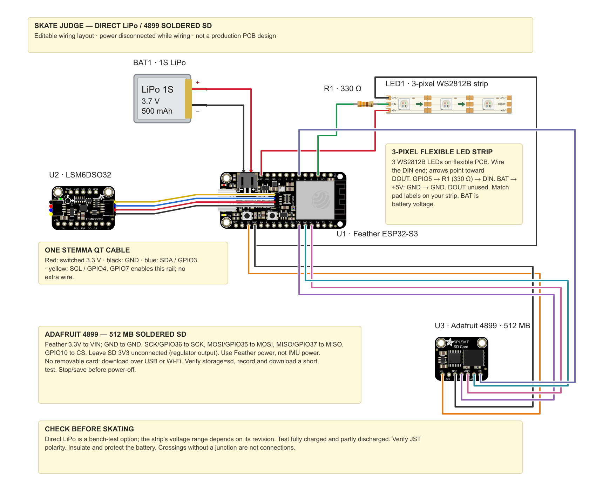

# Judgy Skateboard

Record skateboard motion from an Adafruit LSM6DSO32 (accelerometer + gyro)
wired to an ESP32-S3 over STEMMA QT / Qwiic. Record webcam video in the web UI,
label makes, bails, and falls, and align webcam or phone footage using timestamped LED flashes.
The original live 3D orientation viewer is also included.



The review tool suggests audio- and IMU-based pop/contact pairs for human review
and records background activity types. An [offline attempt detector](docs/attempt-detector.md)
scans continuous IMU recordings for trick attempts, including makes, bails, and
falls. Separate [feature-based](docs/landing-baseline.md) and
[raw-signal CNN](docs/landing-cnn.md) landing models evaluate landed versus
not-landed kickflips using known contact times. An expanded
[multi-task CNN](docs/trick-cnn.md) adds experimental trick naming, magnitude
channels, separable convolutions, int8 export, and device benchmarks. Its
accuracy remains limited; live automatic judgments are not implemented.
A board-mounted IMU measures the board's motion, which does not always reveal
whether the rider stayed on.
Start with [your first dataset recording](docs/first-recording.md). The
[hardware and recording reference](docs/recording.md) covers wiring, file formats,
and the model plan.

[Research papers and reading notes](reference/README.md) cover skateboard IMU
trick recognition, landing-outcome limitations, and audio-feedback precedents.

```
firmware/imu_logger/   208 Hz sensor FIFO to SD or internal flash, timestamped LED sync
firmware/imu_stream/   legacy live stream for the orientation viewer
capture/onboard.py    onboard recording controls, verified download, recovery, CSV import
capture/session.py    recorder, human outcome labels, phone/video clock alignment
capture/dataset.py    collection progress and versioned datasets across reviewed sessions
learning/landing.py   offline landing baseline, session-held-out evaluation, saved inference
learning/attempts.py  continuous IMU attempt detection, event evaluation, saved inference
learning/landing_cnn.py raw six-channel landing CNN, grouped evaluation, saved inference
learning/trick_cnn.py matched multi-task/magnitude/separable CNN experiments
learning/export_trick_cnn.py int8 conversion and held-out quantization evaluation
firmware/trick_benchmark/ standalone S3 inference parity/memory/latency benchmark
capture/controls.html local webcam recording and countdown UI (--controls)
viz/imu_viz.py         pygame + OpenGL viewer: Mahony sensor fusion, calibration, 3D board with axes
viz/render_overlay.py transparent 3D skateboard + synchronized sensor/audio graphics for video editing
viz/trick_review.py    video review, audio/IMU candidates, activity labels, LED alignment
flash.sh               compile + upload with arduino-cli
flash-feather.sh        preset: Feather S3 8MB / no PSRAM, five-pixel WS2812B/E strip on GPIO5
tests/                 sensor/video integrity, local HTTP, and webcam controller checks
```

## Your hardware and pinout

An [editable Fritzing wiring project](hardware/fritzing/README.md) is included,
with bundled parts and a preview of the direct-LiPo prototype using the new
Adafruit 4899 512 MB SD board. The [SD soldering guide](hardware/fritzing/sd-4899-wiring.png)
shows its pin labels and how to reuse the old SD wires.

A [parametric OpenSCAD enclosure](hardware/enclosure/compact/README.md) includes PETG print
files, a screw-mounted deck base, a Velcro alternative, and a recessed LED mount
integrated into the enclosure's side.
Check the battery dimensions and mounting clearance before printing.

This setup uses the Adafruit Feather ESP32-S3 **8 MB flash / no PSRAM**, an
LSM6DSO32 IMU, a **3.7 V 500 mAh LiPo**, and a **cut three-pixel WS2812B RGB strip**.
The Fritzing artwork shows the three-pixel flexible PCB strip. The new
[compact enclosure](hardware/enclosure/compact/README.md) fits the Adafruit 4899
soldered SD board and a two-pixel flexible strip, with small holder samples to
check the provisional strip dimensions before printing. The firmware preset
still defaults to five pixels; use `SYNC_LED_COUNT=3 ./flash-feather.sh` for
the current three-pixel strip.
For the first direct-LiPo bench test, wire with power disconnected:

| Connection | Destination |
| --- | --- |
| LiPo plug | Feather battery JST socket, with matching polarity |
| Feather `BAT` | Strip `5V` / `+` input (direct-LiPo prototype) |
| Feather `GND` | Strip `GND` |
| Feather header printed **5** (GPIO5) | Strip `DIN`, preferably through a 330 Ω resistor near `DIN` |
| Strip `DOUT` | Leave unconnected |
| Feather STEMMA QT socket | LSM6DSO32 STEMMA QT socket |

**The label “5” means GPIO5, not 5 volts or the fifth header position.**
The resistor is recommended protection on the data wire, not a strict requirement
or an LED brightness resistor. A short-wire bench test can omit it.

Adafruit documents direct LiPo power for short NeoPixel chains; the replacement
strip's exact voltage range depends on its revision. Test visibility and correct colors as the battery runs
down before relying on it for sync; a regulated 5 V supply with a level shifter
is the fallback. See [power details and manufacturer sources](docs/recording.md#direct-lipo-wiring-for-the-first-test).

## Native iPhone recorder

The [first native iPhone app](ios/README.md) records video at the highest supported
frame rate, controls the board over Wi-Fi, and saves verified motion downloads
with the original video. An external-camera mode keeps the same board controls.
Open `ios/SkateJudge.xcodeproj` to install a development build on your iPhone.
Export sessions to the existing desktop review workflow with
`capture/import_mobile.py`. Physical-device recording and field validation remain
necessary; see the app guide for setup, recovery, and current limits.

## First dataset recording

Flash the onboard logger, then initialize its unused storage once over USB:

```bash
./flash-feather.sh
uv run capture/onboard.py --board serial:auto initialize
```

Initialization refuses to erase a nonblank, unrecognized partition. The logger
keeps the preset's existing 1.5 MiB data partition; it does not repartition flash.

For battery operation, join **SkateJudge-XXXX** (password **skate-judge**), then:

```bash
uv run --offline capture/onboard.py record --rider rider-01 --board-name deck-01
```

Open the printed localhost URL. Enable microphone audio if you want audio onset
suggestions. **Record video + sync** starts webcam recording, waits for video
bytes to reach the laptop, starts onboard motion recording, checks its measured
rate, and only then begins the three-second LED countdown.

Acceleration and rotation use **nominal 208 Hz** acquisition through the sensor FIFO and are
saved on the **SD card when available**, with internal flash as the fallback
selected at boot. The page shows the storage destination, actual rates, errors,
and free space. The tested sensor measures about 196.5 Hz, consistent with its
factory clock calibration. Wi-Fi carries commands and status during capture; losing the connection
does not stop motion logging. Download happens after acquisition stops.

Repeat the sync countdown near the end, wait for the flash, then choose
**Stop & save video + board data**. Keep the tab and terminal open until both
are saved. The raw file is checksum-verified, imported into `samples.csv` and
`events.jsonl`, and retained on the board. Match the visible flashes in the
[review tool](docs/trick-review.md) to align video and motion.

Start with **one-minute test batches**. If using internal flash, its existing
partition holds only minutes; SD provides more capacity. Download and verify
each batch, then explicitly delete its onboard copy to reclaim space. See the
[first recording guide](docs/first-recording.md)
and [onboard storage/recovery reference](docs/onboard-recording.md).

For a USB bench check, use `--board serial:auto` before `record`. For a separate
phone camera, start that camera yourself and check the external-camera option
before syncing. Sessions are saved under `sessions/` and excluded from Git.

### Find and delete a test recording

Choose **Stop & save video + board data** and wait until saving finishes. The
terminal prints `Session: ...`, which is the laptop folder for that run. To
choose an easy-to-find folder before a USB test, use:

```bash
uv run --offline capture/onboard.py --board serial:auto record --output sessions/test-001
```

Use a new folder for each test. After saving, its `metadata.json` identifies the
run with `onboard_id`, its board storage with `onboard_storage` (`sd` or `flash`),
and its downloaded raw file with `onboard_raw_file`. The folder also contains
`samples.csv`, `events.jsonl`, and any video recorded through the webcam UI.

To inspect the board over USB, quit the saved recorder first to release the
serial port, then run these commands from the repository directory:

```bash
uv run --offline capture/onboard.py --board serial:auto status
uv run --offline capture/onboard.py --board serial:auto list
```

`status` shows the current storage destination in `storage` and remaining space
in `free_bytes`. `list` shows each saved run's `id`, `storage`, and `bytes` across
both mounted media. Match the ID to your session's `metadata.json`; the list is
not sorted by recording time. SD originals live at `/skate-judge/<id>.bin` on
the card. Downloading leaves the original on the board.

To remove one board copy, replace `<id>` and `<session>` below with your run's
32-character ID and laptop folder. Use `--storage flash` instead if that run's
storage is `flash`:

```bash
uv run --offline capture/onboard.py --board serial:auto delete "<id>" --storage sd \
  --downloaded "sessions/<session>/onboard-<id>.bin"
uv run --offline capture/onboard.py --board serial:auto list
```

The single-run `delete` command requires a downloaded raw file with a matching
ID and checksum. If you have not downloaded the run, retrieve it into a new folder first:

```bash
uv run --offline capture/onboard.py --board serial:auto download "<id>" --storage sd \
  --output sessions/recovered-test-001
```

Then use that folder's `onboard-<id>.bin` for `--downloaded`. To discard the
entire test, delete the board copy first, then move its laptop session folder
to Trash in Finder. Board deletion leaves the laptop files in place; deleting
the laptop folder alone does not reclaim board storage.

For Wi-Fi, join **SkateJudge-XXXX** and omit `--board serial:auto` from these
commands. The standalone `test-led` command creates no recording to clean up.

### Wipe all board recordings in one command

Stop any recording and quit the USB recorder, then run:

```bash
uv run --offline capture/onboard.py --board serial:auto wipe --yes
```

This permanently deletes **all recordings on both mounted SD and internal
flash**, including runs you have never downloaded. No download is required.
Laptop session folders, other SD card files, firmware, Wi-Fi credentials, and
pin settings are kept. The command works with the current logger firmware;
no reflash is needed.

Add `--storage sd` or `--storage flash` to clear only that medium. For Wi-Fi,
join **SkateJudge-XXXX** and omit `--board serial:auto`. `--yes` is required to
confirm deletion. The board must be idle; the command never stops a recording
for you. It reports each deletion and checks that the selected storage is empty
of recordings. If interrupted, rerun it to clear the remaining files. Storage
that is not mounted cannot be wiped.

## Review a recorded trick

For an IMU worn on the waist or lower back, the experimental
[jump peak view](docs/jump-peaks.md) steps directly to each estimated apex:

```bash
uv run viz/trick_review.py sessions/jumps-001/clip.mov --jump-peaks
```

Match the LED flashes, then use **Next peak / Previous peak** (N/P). Peaks are
estimated from flight midpoints and still need validation against real video.

The [review guide](docs/trick-review.md) explains audio candidates, an experimental
IMU filter for background sounds, editable pop/contact boundaries, and matching
LED flashes to the sensor clock.
With FFmpeg installed, run:

```bash
uv run viz/trick_review.py sessions/<session>/webcam-<id>.webm
```

Open the printed local URL, match the LED flashes, then label attempts in the
same page. Choose the trick and outcome, or **Not a trick** for an onset false
positive; saving advances to the next suggestion. Labels save to `labels.jsonl`
with aligned sensor times. **Download saved labels** exports this clip's current
labels. Audio suggestions and unreviewed time remain unlabeled until you decide.

Recordings with onboard motion events enabled also show free-fall, wake-up, and
orientation bands after LED alignment. Click an event to inspect its video;
the bands preserve polling uncertainty and do not assign outcomes. New dataset
exports include these observations in `motion_events.jsonl`. Older recordings
show event data as unavailable. Restart the review server after updating.

## Accumulate labeled sessions

Each session keeps its raw recordings and saved labels. After finishing or
correcting labels (for example, in `sessions/a7s-018`), run these commands from
the repository root to refresh the combined dataset from **all labeled
`sessions/a7s-*` directories**:

```bash
python3 capture/dataset.py status --labeled-only --allow-sample-gaps a7s-018
python3 capture/dataset.py build --labeled-only --allow-sample-gaps a7s-018 \
  --output datasets/a7s-v3
```

Choose an unused version directory each time (`a7s-v4`, `a7s-v5`, and so on).
Existing snapshots are immutable; saving labels does not refresh them. There is
no need to download or manually merge labels from the review UI.

`--labeled-only` skips sessions with missing or empty `labels.jsonl`, so unfinished
unlabeled recordings do not block the refresh. Omit it from `status` to inventory
every session. Labeled sessions still receive all alignment and sensor quality
checks; unreadable labeled sessions block the build.

`--allow-sample-gaps a7s-018` includes this complete recording despite its
`sample_gaps_over_10ms` flag: ten sample intervals were 10.1–10.5 ms, while
the typical interval was about 5.1 ms. Repeat this option on future refreshes
to keep including it. This exception applies only to the named session, only
when that is its sole onboard quality issue, and still excludes individual
windows with gaps over 30 ms, clipping, or other eligibility failures. The
source quality flag is retained; the report and manifest record the exception.
Omit the option for the original strict session policy. See the
[dataset guide](docs/dataset.md#accepting-a-session-with-small-sample-gaps) for details.

Check the printed counts and exclusions, then inspect the new snapshot's
`report.json` and `manifest.jsonl`. The manifest includes the latest revision of
every saved label and any exclusion reasons; `samples.csv` contains only eligible
IMU windows with session/rider IDs in the manifest. A saved label can be excluded
by a recording quality flag, stale alignment, or a bad sensor window. Investigate
these issues before using excluded labels for training; the export does not clear
quality flags.

See [dataset collection and export](docs/dataset.md) for exclusions, file formats,
and how to plan the first 100 attempts. Sessions and exports are local and
excluded from Git; back up the original session directories separately.

## Detect trick attempts

Train and evaluate the IMU-only attempt detector on full recordings associated
with a frozen dataset, then scan a CSV without providing labels or contact times:

```bash
uv run learning/attempts.py train datasets/a7s-v7 --output .build/attempts-v1
uv run learning/attempts.py scan --model .build/attempts-v1/model.json \
  --samples sessions/a7s-027/samples.csv --output .build/a7s-027-attempts.json
```

Choose unused output paths. The training command holds out whole sessions and
reports attempts caught, false events per reviewed background minute, duplicates,
and unclassified detections. The scan example uses a training recording, so its
output is a usage check; use the run's held-out report to assess performance.
See the [attempt detector guide](docs/attempt-detector.md) for results and scope.

## First landing baseline

Train and evaluate the kickflip baseline on a frozen dataset:

```bash
uv run learning/landing.py train datasets/a7s-v7 --output .build/landing-kickflip-v1
```

Choose a new output directory for each run. This writes held-out predictions,
metrics, exclusions, and a portable JSON model. It holds out whole sessions and
compares against an always-miss baseline. It requires a known attempt and contact
time; it does not detect attempts in continuous recordings. See the
[baseline guide and first results](docs/landing-baseline.md) for inference,
limitations, and test commands.

## Raw-signal landing CNN

Train a small CNN on the same landing windows, with feature baselines refitted
on identical session splits:

```bash
uv run learning/landing_cnn.py train datasets/a7s-v7 --output .build/landing-cnn-v1
```

The default experiment runs three fixed seeds and saves seed 0, without choosing
the seed from test results. It uses six channels, 230 resampled points, and
6,345 parameters. Outputs include held-out predictions, training histories,
and float32 weights with a prediction command. See the [CNN guide](docs/landing-cnn.md)
for results and limitations; this does not deploy an int8 model to the board.

## One-time setup

```bash
brew install arduino-cli uv
arduino-cli core install esp32:esp32 --additional-urls https://espressif.github.io/arduino-esp32/package_esp32_index.json
```

The Adafruit LSM6DS library (plus BusIO and Unified Sensor) is installed into
`./.arduino` the first time `flash.sh` runs. NeoPixel builds also install
Adafruit NeoPixel there, so nothing touches your global Arduino sketchbook.

## Flash the board

For onboard capture with this Feather, use `./flash-feather.sh`. The generic
`./flash.sh` defaults to the legacy stream sketch used by the viewer.

Both scripts accept `--compile-only` to build without uploading.

The generic script builds for the `esp32s3` target with USB CDC on boot, so it
talks over the ESP32-S3's native USB port. It probes the usual STEMMA QT pin
pairs at startup and, for Adafruit Feathers, switches on the I2C power rail
first. It prints what it found:

```
I,LSM6DSO32 at 0x6A on SDA=3 SCL=4 (Adafruit Feather ESP32-S3 / Reverse TFT, I2C power on GPIO 7)
```

To try specific pins first: `IMU_SDA=3 IMU_SCL=4 IMU_POWER=7 ./flash.sh`.

For your **Adafruit Feather ESP32-S3, 8 MB flash / no PSRAM**, connect the
five-pixel WS2812B/E RGB strip's data circuit to the header marked **5** (GPIO5).
The preset selects the board, IMU wiring, Wi-Fi, and all five pixels:

```bash
./flash-feather.sh --compile-only  # build first
./flash-feather.sh                 # upload once connected
```

All five pixels flash white for 150 ms on `sync`, then turn off. Brightness
defaults to the maximum 255/255; override with `SYNC_LED_BRIGHTNESS`. For an RGBW stick,
use `SYNC_LED_RGBW=1 ./flash-feather.sh`.
See [strip wiring and power](docs/recording.md#five-pixel-ws2812be-strip)
before connecting it. Direct-LiPo wiring uses `BAT`; the Feather's `USB` pin
only supplies 5 V while USB is connected.

## Export transparent graphics for editing

After saving trick labels and matching the LED flashes, render a 3D skateboard
with synchronized onset, accelerometer, and gyroscope graphics:

```bash
uv run viz/render_overlay.py sessions/a7s-001 --video C0642.MP4 \
  --nose-axis x --up-axis=-z --width 1080 --height 1920
```

This writes one vertical transparent ProRes 4444 clip per attempt and PNG previews.
Add `--reel` for a combined reel.
If the board was level and still at every matched flash, add `--flat-syncs`
to use those moments as tilt and gyro-bias calibration references.
See [transparent overlays](docs/transparent-overlays.md) for slow motion,
mounting controls, timing, and editing instructions.

For isolated images comparing makes and bails, run
`uv run viz/plot_attempts.py sessions/a7s-001 --video C0642.MP4`.
This exports comparison sheets and one detailed PNG per attempt to
`sessions/a7s-001/plots/C0642-pop-contact/`, using shared scales and saved
pop/contact markers. Each detailed image includes accelerometer and gyro
magnitudes plus raw X/Y/Z traces.

## Run the viewer

The orientation viewer requires the legacy stream firmware. Switch explicitly:

```bash
SKETCH=firmware/imu_stream ./flash-feather.sh
```

Return to `./flash-feather.sh` and `capture/onboard.py` for onboard dataset capture.

```bash
uv run viz/imu_viz.py
```

The port is auto-detected; pass `-p /dev/cu.usbmodem101` to pick one, or
`--demo` to run without hardware. Keep the board still for the first two
seconds while the gyro bias is measured.

| Key | Action |
|-----|--------|
| C | re-calibrate the gyro bias (hold the board still) |
| Z | zero the heading (yaw) |
| M | toggle fused (gyro + accel) and tilt-only (accel) modes |
| R | reset the filter, peaks, and clip counters |
| S | save a screenshot |
| drag / wheel | orbit / zoom the camera |
| Esc | quit |

Because the LSM6DSO32 has no magnetometer, heading (yaw) is integrated from the
gyro and slowly drifts; roll and pitch are pinned by gravity and do not. Press
`Z` whenever you want the heading re-zeroed.

The firmware runs the accelerometer at ±32 g and the gyro at ±2000 dps (about
2294 dps before the 16-bit readings actually saturate), so deck landings and
fast flips stay in range. The HUD shows the peak accel and gyro seen so far
against those limits, counts samples that reached full scale, and flashes a red
`CLIPPING` warning when one does. Press `R` to reset the peaks and counters.

## Serial protocol

One line per sample, targeted at 100 per second, accel in m/s^2 and gyro in rad/s:

```
D,<device_us>,<ax>,<ay>,<az>,<gx>,<gy>,<gz>,<temp_C>,<sequence>,<boot_id>
```

`device_us` is the 64-bit monotonic microsecond clock since boot. The sample
sequence is an unsigned 32-bit counter; the random eight-character hex boot ID
changes on reset. The viewer accepts these trailing fields. The recorder also
accepts the original nine-field format and unwraps its 32-bit microsecond clock.

At startup the board also prints `R,<accel_sat_ms2>,<gyro_sat_rads>`, the values
at which its raw readings saturate, which the viewer uses for its clipping
check. `I,...` lines are informational, `E,...` lines are errors. Sending `i`
asks the board to repeat its info lines.

Sending `s` requests a 150 ms pulse. Both LED edges produce:

```
S,<device_us>,<sync_id>,<edge>,<led_enabled>,<boot_id>
```

`edge=1` is the rising edge; `edge=0` is the falling edge. `led_enabled=0`
means only an event was recorded, with no physical flash. Each timestamp is taken
immediately before its LED write; it approximates the physical edge time.

With Wi-Fi enabled, UDP port 5050 accepts single-byte commands `i`, `?`, `s`,
and `k` (heartbeat). A recorder acquires a five-second lease by sending one
of these; packets go back to that client's address and port. The recorder
renews every two seconds. One client owns the lease at a time. UDP can lose
packets; sequence gaps and timing gaps are saved for quality review.

## Checks

```bash
python3 -m unittest discover -s tests -v
node --test tests/test_webcam.mjs tests/test_trick_review.mjs tests/test_storage.mjs tests/test_battery.mjs
./flash-feather.sh --compile-only
./flash.sh --compile-only
SKATE_WIFI=1 ./flash.sh --compile-only
```

## Troubleshooting

- **No `/dev/cu.usbmodem*` after plugging in.** On Apple Silicon a new accessory
  first needs the "Allow accessory to connect" approval. Other apps that open
  every USB device (Chrome's WebUSB, Spotify) can also grab the port before the
  serial driver does; unplugging and replugging the board usually fixes it.
- **`./flash.sh` fails while "Connecting..."** The reset into the bootloader can
  re-enumerate the USB device and kill the port node; the script already retries
  once, otherwise replug and rerun.
- **`E,no LSM6DSO32 found`** Check the STEMMA QT cable, and if your board is not
  in the sketch's candidate table, pass the pins explicitly with `IMU_SDA` /
  `IMU_SCL` (and `IMU_POWER` if the port has a power-enable pin).
