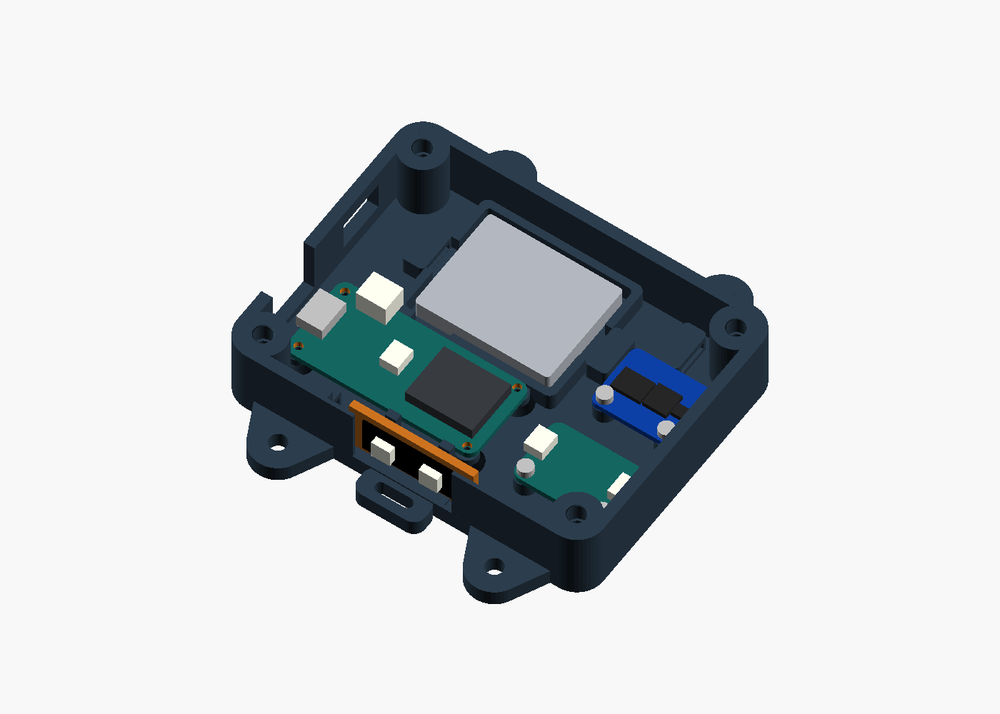
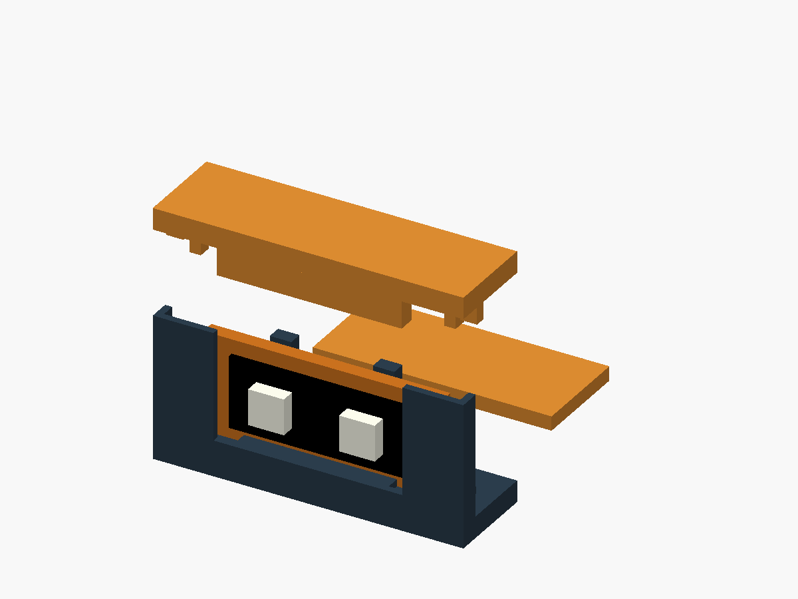
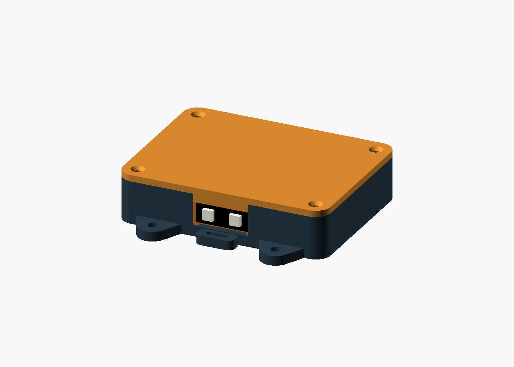

# Compact enclosure — R10 / XTSD + flexible LEDs

**Prototype, 2026-10-26.** This version fits the **Adafruit 4899 / Mouser
485-4899** soldered SD storage board and a **two-pixel WS2812B strip**.
The shell shrinks from **108 × 80 × 23 mm to 98 × 75 × 23 mm**: **14.9% less
footprint and bounding-box volume**, with the same wall, floor and lid thickness.
The 23 mm height keeps room for the existing switch, battery and soldered wires.
Both the base and lid must be reprinted. R9 lids and deck-hole spacing do not fit.
**Print this version in PETG**, including the carrier and fit samples.



The strip pitch is the user's approximate **½ inch / 12.7 mm**. Its **10 mm
width, 25.4 mm cut length, 0.7 mm flex-plus-adhesive thickness, and 2 mm LED
projection are provisional**, not measured product specifications. Print the
small holder samples first. The existing assumed wrapped battery remains
**36 × 29 × 5 mm**, with 1.5 mm clearance per side and a 0.8 mm insulating pad.
Measure the actual strip, soldered leads and wrapped battery before a full print.

## Print files

| Part | Purpose / print orientation |
| --- | --- |
| [base.stl](exports/base.stl) | Rigid deck mounting; flat back on bed, cavity upward |
| [base-velcro.stl](exports/base-velcro.stl) | Alternative without bolt ears; flat back on bed |
| [lid.stl](exports/lid.stl) | Exterior face on bed, tabs upward; flip physically to assemble |
| [led-carrier.stl](exports/led-carrier.stl) | 33.4 × 14 × 2 mm backing plate; print flat |
| [led-fit-base.stl](exports/led-fit-base.stl) | Small copy of the side holder |
| [led-fit-lid.stl](exports/led-fit-lid.stl) | Matching holder lid; hold seated for the fit test |
| [sd-fit-base.stl](exports/sd-fit-base.stl) | Two-hole XTSD mounting sample, 23.59 × 19.78 × 7 mm |
| [fit-coupon.stl](exports/fit-coupon.stl) | Existing insert/pilot fits: 4.4/4.6/4.8 mm insert bores |

Use your printer's calibrated **PETG filament profile**, a 0.4 mm nozzle,
0.20 mm layers, **five perimeters**, six top/bottom layers, and **40% gyroid
infill**. Use solid local infill at posts and lugs if the slicer leaves voids.
Select temperatures, cooling and build-plate preparation for your actual PETG
and printer; see [Prusa's PETG guidance](https://help.prusa3d.com/article/petg_2059).
The strap tunnels and switch opening still have bridges; inspect them in the
slicer. Printability and impact retention have not been physically tested.
Print the insert/pilot coupon and LED holder samples in the **same PETG and
settings** as the full case; an earlier PLA fit does not establish PETG fit.
The [R9 assembly guidance](../README.md) still applies to fasteners and deck
attachment. Its PLA profile, material notes, board coordinates and LED holder
are historical and do not describe this version. Use PETG-appropriate heat-set
installation settings for your inserts and test their retention on the coupon.

The rigid version is **98 × 101 mm including ears**, with M4-clearance hole
centers on a **58 × 87 mm rectangle**; this is **not truck-bolt spacing**.
The earless version is **98 × 89 mm including tether lugs**. Use a secondary
tether and verify actual deck and wheel clearance. The rigid mount retains the
best coupling for IMU recordings; hook-and-loop can add motion artifacts.



## Assembly changes

1. **Storage:** fit the 4899 with its two mounting holes toward the IMU and its
   seven solder pads toward the rear wall, components toward the lid. Use two
   M2 × 5 mm plastic-compatible screws, heads no larger than 4 × 2 mm.
   The official holes are **16.51 mm apart**, not the old four-hole SD pattern.
   Posts are 4 mm above the floor (PCB underside Z=7), with 5.6 mm diameter and
   1.7 mm blind pilots. Route direct-soldered flexible wires toward the nearby
   tie anchor at (79,64). No tall plug-in headers are assumed. It sits beside the
   battery strap anchor; keep the strap and loose leads
   out of the board and screw-head area.
2. **LEDs:** cut only at the strip's marked cut points, leaving usable DIN pads.
   Bond its insulated, non-component back to the printed carrier with thin
   compatible adhesive; center the segment with **4 mm carrier margin at each
   end and 2 mm above/below**. LEDs face out toward the camera. The carrier
   slides into the side channel and the lid limits its upward travel; adhesive
   retains the flexible strip itself. Solder first, insulate the joints, route
   leads through the open end passage and tie them to the adjacent anchor.
   Try the soldered carrier in the sample base and lid without forcing it.
   Default LED faces are recessed **0.8 mm** behind the wall; no waterproof seal
   or clear cover is supplied. Check the two-pixel flash in actual camera footage.
3. **Feather:** reuse the four M2 × 5 mm screws and reinforced R9 post geometry:
   5.6 mm posts, 8 mm tapered feet, 4 mm height. Its position moves 3.2 mm toward
   the LED wall; USB is still on the x=0 short wall. The USB opening moves with it.
4. **IMU:** reuse its two M2 × 5 mm screws. Keep its **existing physical
   orientation**, components up and screw row toward the LEDs. Its origin moves
   from (74,17) to (68,14), a **−6 / −3 mm translation**, with no rotation.
   Record R10 and the new position in subsequent session mounting metadata;
   translating a sensor can change its measured acceleration during rotation.
   Use the left-facing STEMMA socket, toward the Feather; the layout reserves
   a plug/cable corridor beside the Feather and above the tray edge. Check your
   actual connector and bend radius. The right-facing socket is too close to
   the wall for a plug in this compact layout.
5. **Battery/switch/lid:** reuse the padded, loosely strapped battery and the
   measured 13.5 × 8.4 mm switch opening. The switch stays centered at Y=50,
   Z=11.5 on x=0. Check its actual body depth, terminals and wire bends against
   the battery tray; only the opening dimensions were supplied. Reuse four
   M3 × 4 × 5 mm inserts and M3 × 8 mm or existing M3 × 12 mm countersunk screws.
   Check that screws clamp the lid before bottoming; install inserts with all
   electronics removed. The insert and screw-relief depths match R9.



## Storage and firmware

The 4899 is **512 MB SD-protocol storage soldered onto the breakout**, so there
is no removable card or card-access opening. It uses an SD library over SPI;
files must be copied through the Feather. The existing logger already provides
USB-serial and Wi-Fi downloads. Keep the same SPI signals and CS assignment,
connecting by **pin labels**, not the old breakout's physical pin order. See
[the existing SD wiring](../../../docs/onboard-recording.md#sd-card-and-internal-flash) and
[Adafruit's pinouts](https://learn.adafruit.com/adafruit-spi-flash-sd-card/pinouts).

| Feather ESP32-S3 | Adafruit 4899 |
| --- | --- |
| 3.3V | VIN |
| GND | GND |
| SCK / GPIO36 | SCK |
| MO / GPIO35 | MOSI |
| MI / GPIO37 | MISO |
| 10 / GPIO10 | CS |

Do not connect the breakout's 3V3 regulator **output** as though it were VIN.
This new board has not been bench-validated with this logger: verify `storage=sd`,
record a short batch and download it before riding; the logger can otherwise
fall back to its much smaller internal flash. Do not apply the old removable-card
instructions to the soldered chip or format storage just to change enclosures.

If physically shortening the strip to two pixels, select its count explicitly:

```bash
SYNC_LED_COUNT=2 ./flash-feather.sh --compile-only
# When ready to upload the same configuration:
SYNC_LED_COUNT=2 ./flash-feather.sh
```

This retains RGB/GRB on GPIO5. The repository's five-pixel default is unchanged.
For a one-pixel build, set `led_count=1` and the measured `strip_length` in CAD,
then use `SYNC_LED_COUNT=1` for firmware. Recheck visibility with fewer LEDs.

## CAD, sources and checks

Open [skate-judge.scad](skate-judge.scad). The useful parameters are `led_pitch`,
`led_count`, `strip_length`, `strip_width`, `strip_backing_thickness`, and
`led_package_height`. These are mechanical inputs, not firmware settings.
Changing the strip length changes its carrier, holder, lid and fit samples;
regenerate them together. The checked-in STLs contain **only the defaults**.
The current compact holder accepts segments up to 32 mm long and strips 8–10.5 mm
wide; a wider strip requires revisiting height and clearances. For one LED at
nominal pitch, start with `led_count=1; strip_length=12.7;` and measure the cut.

The storage board uses the [official Adafruit Eagle drawing](https://github.com/adafruit/Adafruit-SPI-Flash-SD-Card-PCB/blob/main/Adafruit%20SPI%20Flash%20SD%20Card.brd),
checked 2026-10-26: 21.59 × 17.78 mm outline, 2.5 mm holes at (2.54,15.24) and
(19.05,15.24), before the 180° in-plane turn. The [product page](https://www.adafruit.com/product/4899)
rounds its assembled dimensions to 21.4 × 17.7 × 2.9 mm. Feather and IMU geometry
sources are unchanged from the [R9 source table](../README.md#dimensions-and-assumptions).
Electronics shown in the previews are simplified envelopes, not detailed models.

```bash
python3 hardware/enclosure/compact/build.py --output /tmp/judgy-compact
python3 hardware/enclosure/compact/verify_fit.py --exports /tmp/judgy-compact
# To replace this variant's checked-in generated files:
python3 hardware/enclosure/compact/build.py --replace
python3 hardware/enclosure/compact/verify_fit.py
```

[Mesh validation](exports/validation.json) checks closed, consistently wound,
single connected parts with positive volume and z=0 print placement.
[Fit validation](exports/fit-validation.json) checks the actual exported parts,
including the physically rotated lid and carrier, electronics, wired carrier
insertion, XTSD screw posts and pilots, strap clearance, switch opening, lid
inserts and reinforced Feather posts. Assumptions are recorded in the report.
The independent fixture coordinates describe the supplied defaults; revising
the layout also requires revising and rerunning those fit fixtures.
These checks do not establish real cable routing, strip adhesion, camera
visibility, battery fit, switch depth, print quality or impact survival.
